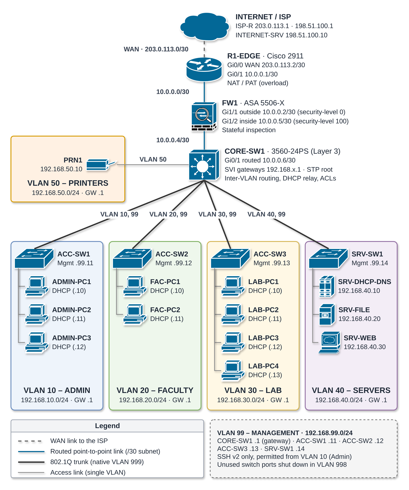
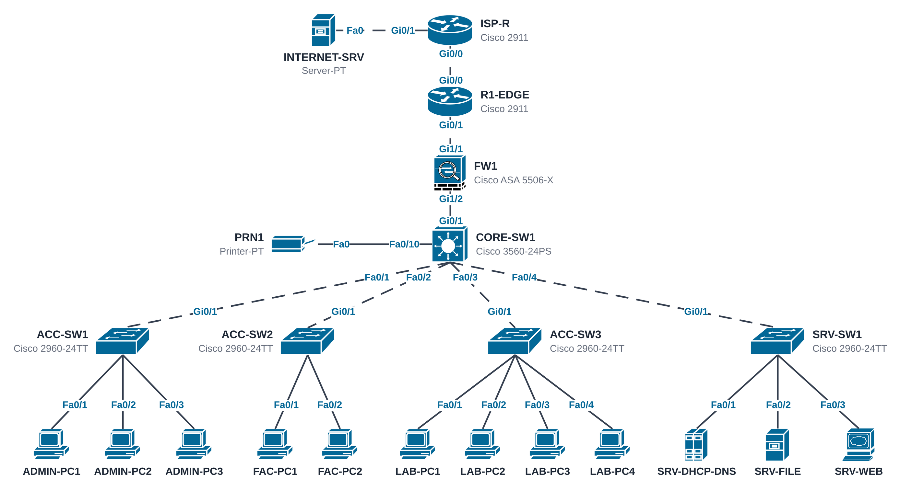

# Network diagrams

Both diagrams were drawn in draw.io with the official Cisco stencils and are stored as editable `.drawio` source files alongside high-resolution PNG exports used in the report.

| Figure | Files | Shows | Open live |
|---|---|---|---|
| Figure 1 – Logical topology | [`Figure1_Logical_Topology.drawio`](Figure1_Logical_Topology.drawio) · [`.png`](Figure1_Logical_Topology.png) | VLANs, subnets, gateways, device addresses and security zones | [draw.io](https://app.diagrams.net/#Uhttps://raw.githubusercontent.com/Moparapairayat/NIS-Task-2/main/02-diagrams/Figure1_Logical_Topology.drawio) |
| Figure 3 – Physical topology | [`Figure3_Physical_Topology.drawio`](Figure3_Physical_Topology.drawio) · [`.png`](Figure3_Physical_Topology.png) | Every cable, the interface at each end and the cable type | [draw.io](https://app.diagrams.net/#Uhttps://raw.githubusercontent.com/Moparapairayat/NIS-Task-2/main/02-diagrams/Figure3_Physical_Topology.drawio) |

Figure 2 is a screenshot of the Packet Tracer workspace and is stored in [`05-screenshots/task2a-design`](../05-screenshots/task2a-design).

## Figure 1 – Logical topology

## Figure 3 – Physical topology and port connections

## Editing

Use the live links above, or go to [app.diagrams.net](https://app.diagrams.net) and choose *File › Open from › Device*. Export updated images with *File › Export as › PNG* at 200 % zoom so that labels stay readable in the report.
