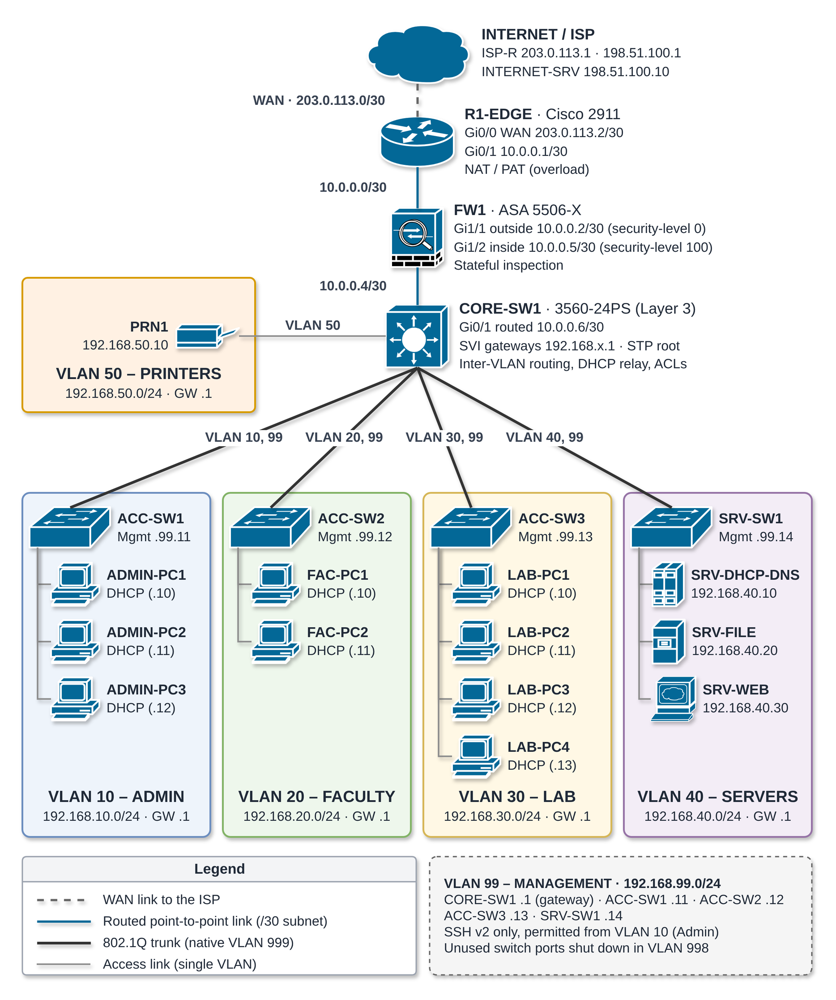

# Campus Network Design, Installation and Services


-555)


Supporting repository for **Task 2 (Learning Outcome 3)** of the Network Information Systems unit: the design, installation and service configuration of a secure campus network for the Netron plc graduate training scenario.

Everything needed to review, reopen or rebuild the network is here: the Packet Tracer files for each stage, the exact commands applied to every device, the draw.io diagrams, and every screenshot used as evidence in the report.

---

## Contents

- [Assessment coverage](#assessment-coverage)
- [Topology](#topology)
- [Network at a glance](#network-at-a-glance)
- [Device inventory](#device-inventory)
- [IP addressing](#ip-addressing)
- [Services](#services)
- [Security controls](#security-controls)
- [Verification results](#verification-results)
- [Repository structure](#repository-structure)
- [How to use this repository](#how-to-use-this-repository)
- [Lab credentials](#lab-credentials)
- [Author](#author)

---

## Assessment coverage

| Part | Assessment criterion | Report sections | Packet Tracer file | Commands | Evidence |
|---|---|---|---|---|---|
| **a** | AC 3.1 – Produce a comprehensive design of a network to a given scenario | 2–13 | [`3.1-NIS-Figure 2.pkt`](03-packet-tracer/3.1-NIS-Figure%202.pkt) | – | [Diagrams](02-diagrams) · [Figure 2](05-screenshots/task2a-design) |
| **b** | AC 3.2 – Install a network according to a predefined network specification | 14–19, Appendix D | [`NIS_Task2b_Installation.pkt`](03-packet-tracer/NIS_Task2b_Installation.pkt) | [Install scripts](04-device-configs/install-scripts) | [30 screenshots](05-screenshots/task2b-installation) |
| **c** | AC 3.3 – Configure network services and applications | 20–26, Appendix E | [`NIS_Task2c_Services.pkt`](03-packet-tracer/NIS_Task2c_Services.pkt) | [Service scripts](04-device-configs/service-scripts) | [22 screenshots](05-screenshots/task2c-services) |

---

## Topology



*Figure 1 – Logical topology. Open the editable versions live in draw.io:*
[**Figure 1 – Logical topology**](https://app.diagrams.net/#Uhttps://raw.githubusercontent.com/Moparapairayat/NIS-Task-2/main/02-diagrams/Figure1_Logical_Topology.drawio) ·
[**Figure 3 – Physical topology and ports**](https://app.diagrams.net/#Uhttps://raw.githubusercontent.com/Moparapairayat/NIS-Task-2/main/02-diagrams/Figure3_Physical_Topology.drawio)

---

## Network at a glance

| Area | Design decision |
|---|---|
| Architecture | Hierarchical collapsed core: one Layer 3 core switch, four access switches, firewall and edge router |
| Devices | 22 in total: 2 × Cisco 2911, 1 × Cisco ASA 5506-X, 1 × Cisco 3560-24PS, 4 × Cisco 2960-24TT, 9 PCs, 4 servers, 1 printer |
| Cabling | 21 copper links: 7 cross-over, 14 straight-through |
| Switching | 8 VLANs, VTP transparent, 802.1Q trunks with native VLAN 999 and pruned allowed lists, core as STP root |
| Routing | Inter-VLAN routing on CORE-SW1 SVIs; static routing to the firewall, edge and ISP |
| Internet | PAT (NAT overload) on R1-EDGE only, to avoid double NAT |
| Services | DHCP with relay, DNS (`college.local`), internal website, FTP, network printer by name |
| Security | ASA stateful firewall, inter-VLAN ACLs, SSH v2 from the Admin VLAN only, port security, DHCP snooping, PortFast with BPDU Guard, unused ports shut in a blackhole VLAN |

---

## Device inventory

| Device | Model | Role | Management / key address |
|---|---|---|---|
| ISP-R | Cisco 2911 | Simulated ISP router | 203.0.113.1 |
| R1-EDGE | Cisco 2911 | Edge router, PAT | 203.0.113.2 (WAN), 10.0.0.1 |
| FW1 | Cisco ASA 5506-X | Stateful firewall (outside / inside) | 10.0.0.2 / 10.0.0.5 |
| CORE-SW1 | Cisco 3560-24PS | Layer 3 core, default gateway for every VLAN, DHCP relay | 192.168.99.1 |
| ACC-SW1 | Cisco 2960-24TT | Admin access switch | 192.168.99.11 |
| ACC-SW2 | Cisco 2960-24TT | Faculty access switch | 192.168.99.12 |
| ACC-SW3 | Cisco 2960-24TT | Computer lab access switch | 192.168.99.13 |
| SRV-SW1 | Cisco 2960-24TT | Server access switch | 192.168.99.14 |
| SRV-DHCP-DNS | Server-PT | DHCP and DNS server | 192.168.40.10 |
| SRV-FILE | Server-PT | FTP file server | 192.168.40.20 |
| SRV-WEB | Server-PT | Internal web server | 192.168.40.30 |
| PRN1 | Printer-PT | Network printer | 192.168.50.10 |
| INTERNET-SRV | Server-PT | Simulated internet web server | 198.51.100.10 |
| 9 × PC | PC-PT | ADMIN-PC1–3, FAC-PC1–2, LAB-PC1–4 | DHCP |

---

## IP addressing

### VLANs and subnets

| VLAN | Name | Subnet | Gateway (CORE-SW1 SVI) | Addressing |
|---|---|---|---|---|
| 10 | ADMIN | 192.168.10.0/24 | 192.168.10.1 | DHCP pool .10–.99 |
| 20 | FACULTY | 192.168.20.0/24 | 192.168.20.1 | DHCP pool .10–.99 |
| 30 | LAB | 192.168.30.0/24 | 192.168.30.1 | DHCP pool .10–.99 |
| 40 | SERVERS | 192.168.40.0/24 | 192.168.40.1 | Static |
| 50 | PRINTERS | 192.168.50.0/24 | 192.168.50.1 | Static |
| 99 | MANAGEMENT | 192.168.99.0/24 | 192.168.99.1 | Static (switch SVIs) |
| 998 | BLACKHOLE | – | – | Every unused port, shut down |
| 999 | NATIVE | – | – | Native VLAN on all trunks, no user traffic |

### Point-to-point links and routing

| Link | Network | Addresses | Static routes |
|---|---|---|---|
| CORE-SW1 Gi0/1 – FW1 Gi1/2 (inside) | 10.0.0.4/30 | .6 / .5 | CORE: 0.0.0.0/0 → 10.0.0.5 |
| FW1 Gi1/1 (outside) – R1-EDGE Gi0/1 | 10.0.0.0/30 | .2 / .1 | FW1: 0.0.0.0/0 → 10.0.0.1, 192.168.0.0/16 → 10.0.0.6 |
| R1-EDGE Gi0/0 – ISP-R Gi0/0 | 203.0.113.0/30 | .2 / .1 | R1: 0.0.0.0/0 → 203.0.113.1, 192.168.0.0/16 → 10.0.0.2 |
| ISP-R Gi0/1 – INTERNET-SRV | 198.51.100.0/24 | .1 / .10 | – |

The public ranges 203.0.113.0/24 and 198.51.100.0/24 are reserved for documentation (RFC 5737), so the lab uses no real public addresses.

---

## Services

| Service | Server | Configuration |
|---|---|---|
| DHCP | SRV-DHCP-DNS | ADMIN-POOL, FACULTY-POOL and LAB-POOL; relayed by `ip helper-address` on CORE-SW1 |
| DNS | SRV-DHCP-DNS | `www.college.local` → .40.30 · `files.college.local` → .40.20 · `printer.college.local` → .50.10 · `www.internet.test` → 198.51.100.10 |
| Web | SRV-WEB | Netron College Intranet home page (HTTP) |
| File transfer | SRV-FILE | FTP with a dedicated `faculty` account; default `cisco` account removed, HTTP disabled |
| Printing | PRN1 | Reachable by name from permitted VLANs |
| Internet | R1-EDGE / FW1 | PAT to 203.0.113.2; ASA inspects ICMP and HTTP so that replies return |

### Inter-VLAN access policy

| From \ To | Admin | Faculty | Lab | Servers | Printer | Management | Internet |
|---|---|---|---|---|---|---|---|
| **Admin (10)** | – | ✅ | ✅ | ✅ | ✅ | ✅ SSH | ✅ |
| **Faculty (20)** | ❌ | – | ✅ | ✅ | ✅ | ❌ | ✅ |
| **Lab (30)** | ❌ | ❌ | – | DNS, web, FTP only | ❌ | ❌ | ✅ |

Enforced by the named ACLs `FACULTY-IN` and `LAB-IN`, applied inbound on the VLAN 20 and VLAN 30 SVIs. Return traffic to the Admin VLAN and DHCP requests are permitted explicitly.

---

## Security controls

| Layer | Control | Where |
|---|---|---|
| Perimeter | ASA stateful firewall: inside (100) to outside (0) allowed, inbound connections blocked | FW1 |
| Routing | Named extended ACLs between departments | CORE-SW1 |
| Management | SSH v2 only, local admin account, VTY access-class limited to 192.168.10.0/24, exec-timeout, banner | All managed IOS devices |
| Device access | Enable secret, console password, password encryption | All IOS devices |
| Access ports | Port security (max 2, sticky, shutdown), PortFast, BPDU Guard | ACC-SW1–3, SRV-SW1 |
| DHCP | DHCP snooping with only the uplink trusted | ACC-SW1–3 |
| Layer 2 | Native VLAN 999, DTP disabled, trunk VLAN pruning, unused ports shut in VLAN 998 | All switches |

---

## Verification results

All tests from the verification plan (Table 9 of the report) passed.

| Test | What was verified | Evidence |
|---|---|---|
| 1 | Access ports in the correct VLANs | [Figure 6](05-screenshots/task2b-installation/03_show_vlan_brief_ACC-SW1.png) |
| 2 | Trunks: 802.1Q, native VLAN 999, allowed VLANs only | [Figure 7](05-screenshots/task2b-installation/04_show_interfaces_trunk_CORE-SW1.png) |
| 3 | PCs receive addresses through DHCP relay | [Figure 15](05-screenshots/task2c-services/12_dhcp_ADMIN-PC1.png) |
| 4 | Inter-VLAN routing and name resolution | [Figure 19](05-screenshots/task2c-services/16_ping_by_name_ADMIN-PC1.png) |
| 5 | Access policy enforced by ACLs | [Figure 20](05-screenshots/task2c-services/17_acl_lab_to_admin_blocked.png) · [Figure 21](05-screenshots/task2c-services/18_show_access_lists_CORE-SW1.png) |
| 6 | Internal website opened by name | [Figure 17](05-screenshots/task2c-services/14_web_www_college_local.png) |
| 7 | FTP login to the file server | [Figure 18](05-screenshots/task2c-services/15_ftp_login_FAC-PC1.png) |
| 8 | Internet access through NAT | [Figure 25](05-screenshots/task2c-services/22_web_www_internet_test.png) · [Figure 26](05-screenshots/task2c-services/23_nat_translations_R1-EDGE.png) |
| 9 | Firewall blocks inbound connections | [Figure 27](05-screenshots/task2c-services/24_firewall_inbound_blocked.png) |
| 10 | SSH allowed from Admin, refused from Lab | [Figure 22](05-screenshots/task2c-services/19_ssh_ADMIN-PC1_allowed.png) · [Figure 23](05-screenshots/task2c-services/20_ssh_LAB-PC1_refused.png) |
| 11 | Port security and DHCP snooping active | [Figure 24](05-screenshots/task2c-services/21_port_security_ACC-SW3.png) · [Figure E7](05-screenshots/task2c-services/E07_dhcp_snooping_ACC-SW1.png) |

The full evidence index, including Appendix D and Appendix E, is in [`05-screenshots`](05-screenshots).

---

## Repository structure

```
NIS-Task-2/
├── README.md                          Project overview (this file)
├── 01-design-document/                Final report (PDF)
├── 02-diagrams/                       Figure 1 and Figure 3 (.drawio source and .png)
├── 03-packet-tracer/                  One .pkt file per stage (2a, 2b, 2c)
├── 04-device-configs/
│   ├── install-scripts/               Task 2b commands for all eight network devices
│   ├── service-scripts/               Task 2c services and security settings
│   └── running-configs/               Final show running-config output
└── 05-screenshots/
    ├── task2a-design/                 Figure 2
    ├── task2b-installation/           Figures 4–13 and D1–D20
    └── task2c-services/               Figures 14–27 and E1–E8
```

---

## How to use this repository

**Review the finished network.** Open [`NIS_Task2c_Services.pkt`](03-packet-tracer/NIS_Task2c_Services.pkt) in Cisco Packet Tracer 9.0.1 or later (free with a Cisco Networking Academy account). Every device is fully configured; use the credentials below to log in.

**Rebuild it step by step.** Start from [`3.1-NIS-Figure 2.pkt`](03-packet-tracer/3.1-NIS-Figure%202.pkt), then apply the files in [`install-scripts`](04-device-configs/install-scripts) and [`service-scripts`](04-device-configs/service-scripts) in their numbered order. Each file states the device, the order, how to paste it and the commands that verify it.

**Edit the diagrams.** Use the live draw.io links above, or open the `.drawio` files at [app.diagrams.net](https://app.diagrams.net) with *File › Open from › Device*.

---

## Lab credentials

These passwords exist only inside the Packet Tracer simulation and are shared so that the network can be reviewed.

| Purpose | Credential |
|---|---|
| Console password (IOS devices) | `Con@2026` |
| Enable secret (IOS) / enable password (ASA) | `Netr0n@2026` |
| SSH (CORE-SW1, access switches, R1-EDGE) | user `admin`, password `Adm1n@2026` |
| FTP on SRV-FILE | user `faculty`, password `Fac@2026` |

---

## Author

**Mopara Pair Ayat**
BITHM College of Professionals, Chattogram
OTHM Level 5 Extended Diploma in Information Technology · Network Information Systems (R/617/2272)
Lab instructor: Afsana Tabassum Tamishra · November 2026
